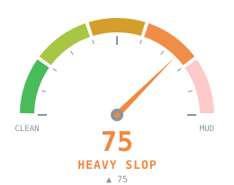
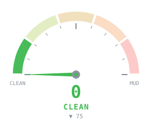

# Slop-O-Meter

**Is your coding agent quietly building a Big Ball of Mud?**

<p>
  
  
</p>

A live experiment from [DOGFOOD.md](DOGFOOD.md): a `/items/count` endpoint built behind an interface, a
repository, a service, a wrapper, an adapter and a factory scored **75, HEAVY SLOP**. Collapsing it back to
`{ count: items.length }` scored **0, CLEAN**.

**Not an LLM vibe score.** Slop-O-Meter is a Claude Code mod that scores every code-changing turn from
0 (clean) to 100 (mud) using deterministic measurements of what the turn changed and how the agent got there:

- **change surface:** how widely the change spreads (a rename repeated across 19 files counts once)
- **complexity delta:** how dense the new control flow is; nesting past 3 levels; functions over 60 lines
- **abstraction growth:** new classes, interfaces and types, especially single-consumer and pattern-named ones
- **change amplification:** machinery (modules, types, wiring) per unit of behaviour added
- **agent churn:** how much of the agent's own editing was thrown away before the turn ended
- **type weakening:** `any`, casts, double casts, `@ts-ignore`, non-null assertions
- **dependency growth**, **duplication delta** and **comment noise** (comments that restate the code)
- **documentation sprawl:** new Markdown files nobody asked for (the `IMPLEMENTATION_SUMMARY.md` genre); docs the
  request asked for are never counted
- **tests:** a bounded risk-reduction modifier; tests never erase structural slop

Every score explains itself. `/slop` answers "why is this 67?" with the points each metric contributed and a
concrete reason for each.

## How it reads a turn

At the start of each turn Slop-O-Meter snapshots your whole working tree as a git tree object, through a
private index, and does the same when the turn ends. The turn is the diff between the two, so **work you
already had uncommitted is never charged to the agent**, and a clean fix inside ugly legacy code can still
score 0: it is the change that is judged, not the file. While the turn runs, it records what the agent's
Edit and Write calls did, which is how it sees churn that the final diff hides.

Scores combine as independent evidence: one strong signal reads as concerning, agreement between signals
pushes toward mud, and a metric that cannot be measured adds nothing (it is shown as `unavailable`, never
invented). Simplification is rewarded: removing abstractions, complexity or duplication subtracts points.

| Score | State |
|---|---|
| 0–20 | CLEAN |
| 21–40 | MILD SLOP |
| 41–60 | GETTING SLOPPY |
| 61–80 | HEAVY SLOP |
| 81–100 | BIG BALL OF MUD |

Crossing into Big Ball of Mud slams the needle into the red once; staying there does not repeat it.

## The guard

A meter that only you can see tells you about slop after the fact. The guard turns the same measurements
into feedback for Claude, while it works:

- **Mid-turn nudges** (`guard: nudge`, the default). When a turn piles up abstractions (a third `…Service`,
  `…Validator` or `…Factory`, or a sixth new type of any name), adds `any`, double casts or `@ts-ignore` to a file,
  writes a second unrequested Markdown file, or edits one file for the fifth time, Claude gets one short note
  beside that tool's result, naming what it measured. Each nudge is said once a turn (type weakening once per
  file, up to three), and you see a toast whenever Claude is nudged.
- **Strict mode** (`guard: strict`). After a turn over your budget, Claude gets a note for its next turn saying
  what drove the score, and the transcript shows you that the note was left.
- **Simplify this change.** A button in the `/slop` pane that asks Claude to simplify the last change, pointing
  at what drove its score and the names behind it (the single-consumer abstractions, the churned files).
  Nothing is sent until you press it.
- **`/slop report`.** The session so far: turns scored, average and median, the worst turn and the best
  simplification, recurring signals, and how often the guard spoke.

The guard never blocks an edit and never changes a score: the numbers measure what happened, whether or not
Claude took the advice. `guard: off` keeps Slop-O-Meter a silent observer.

## Płanetnik

<p>
  
  
</p>

In Polish lore a płanetnik rides the storm clouds and drives the hail. Ours stands on his cloud beside the
gauge and judges each turn: calm skies for clean code, gathering cloud as it gets sloppy, lightning in his raised
fist at Heavy Slop, and a full storm with slop splattered over him at Big Ball of Mud. His face rides in the band
too, from `(•_•)` to `(╬ಠ益ಠ)`. He is presentation only; turn him off with `mascot` in `/config`.

## Install

Requires a Claude Code build with mods (function hooks); developed against 2.1.286. Git must be on the path.

```bash
claude plugin marketplace add <owner>/slop-o-meter
claude plugin install slop-o-meter@slop-o-meter
```

(`<owner>` is the GitHub account hosting this repository.) Installing notes that the `budget` option is not
yet set; until you set it, the default of 40 applies.

## Use

| Where | What you see |
|---|---|
| above the prompt | `SLOP ███░░░░░ 23 MILD SLOP ↗ +4`, and live edit activity while a turn runs |
| `/slop` | the pane: gauge, budget, score breakdown, changed files, history; the explanation in the transcript |
| `/slop explain` | the explanation only |
| `/slop diff` | the files the last scored turn changed |
| `/slop history` | the last 20 scored turns |
| `/slop report` | the session so far: averages, worst turn, best simplification, guard nudges |
| `/slop reset` | clears this repository's history |

The gauge is an SVG instrument in the desktop Code tab, VS Code and mobile, and a cell raster in the
terminal. Where no custom drawing is available, `/slop` still prints the full explanation.

**Settings** (`/config`, under slop-o-meter): `guard` is `off`, `nudge` (default) or `strict`; `mascot` shows or
hides Płanetnik.

**Budget:** an advisory per-turn score, default 40, shown in the pane as over or under. Set `budget` in
`/config` under slop-o-meter. Slop-O-Meter observes; it never blocks an edit.

## Trust

Slop-O-Meter does not send your source code anywhere. By default it:

- makes no network requests
- uses no remote model, and no model at all
- collects no telemetry
- stores no cloud data
- approves no tool calls and reads no secrets or environment

It talks to Claude only through the guard, in plain advisory text built from its own measurements, and every
note it gives Claude is shown to you (a toast for a nudge, a transcript notice for a strict-mode note).
`guard: off` stops it entirely.

What it does on your machine, all auditable in [`hooks/register.tsx`](hooks/register.tsx) and
[`src/git.ts`](src/git.ts):

- runs `git` in your repository: `rev-parse`, `add -A` into a **private** index file
  (`.git/slop-o-meter.index`), `write-tree`, `diff --numstat` and `cat-file --batch`. Your real index, stash,
  branches and refs are never touched. The snapshots add unreferenced objects to `.git/objects`, which
  `git gc` cleans up like any other.
- reads a file's previous contents when the agent overwrites it with Write, to measure the change.
- keeps score history in Claude Code's plugin store (`~/.claude/plugins/store/`), 200 turns per repository:
  scores, metric values, and changed file paths with line counts. Never file contents.

## Supported languages

Change surface, churn and dependency growth work for any language. The structural metrics (complexity,
abstractions, amplification, type weakening, duplication, comments, tests) analyse TypeScript and JavaScript
with a small built-in lexer; when a turn changes only other languages they are reported as unavailable.

## Limitations

- Edits the agent makes through the shell (`sed`, `cat >`) are invisible to churn; the final diff still sees them.
- Anything that changes the working tree during a turn counts as the turn, including your own edits made while it runs.
- Duplication is measured across the files a turn changed, not the whole repository.
- Very large changes are partly skipped: more than 60 analysable files, files over 400 KB, or over 5,000 changed lines.
- The weights are a hypothesis being calibrated by dogfooding. Expect relative ordering to be more reliable
  than any exact number. [DOGFOOD.md](DOGFOOD.md) records every calibration and why.
- One turn's score is not a verdict. The same prompt, run four times by the same model, scored anywhere from 32
  to 65 in our tests: agents vary. Read the reasons, and the trend across turns (`/slop report`).
- The guard reliably changes the behaviours it names (fewer unrequested documents, far less `any`), but in our
  A/B tests that did not reliably lower the total score. See DOGFOOD.md for the numbers.

## The meter watches itself

Slop-O-Meter was built with Slop-O-Meter watching. When the lexer and metrics landed, the meter scored its own
turn **64, HEAVY SLOP**. Some of that was the meter being wrong (four false positives, fixed). The rest was
right: the lexer was two long, deeply nested functions leaning on non-null assertions. Splitting them took the
turn to **22**. The full log, including the experiments that changed the scoring, is in [DOGFOOD.md](DOGFOOD.md).

## Contributing

See [CONTRIBUTING.md](CONTRIBUTING.md). The original design brief is [docs/vision.md](docs/vision.md).

MIT licensed.
